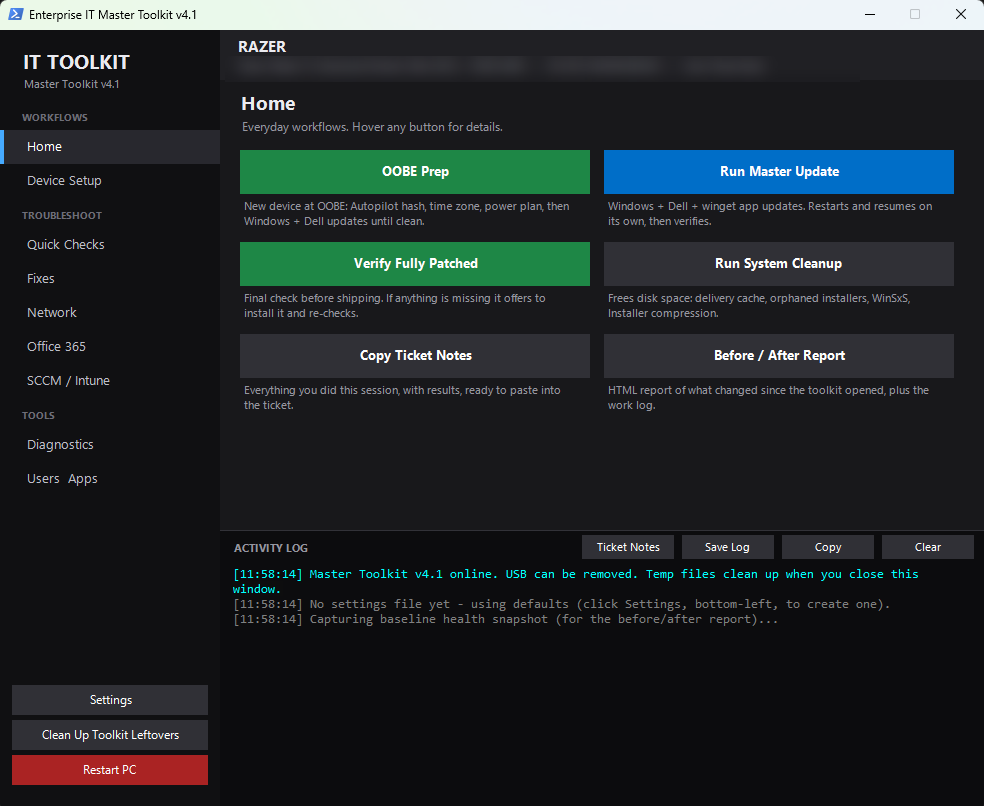
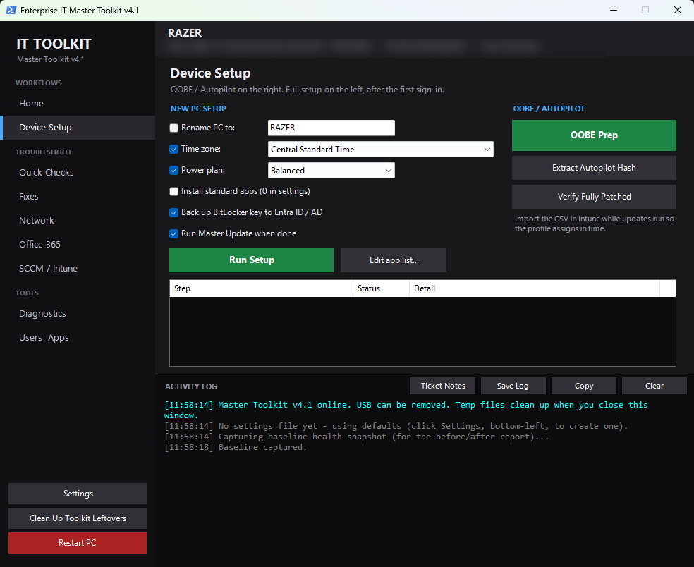
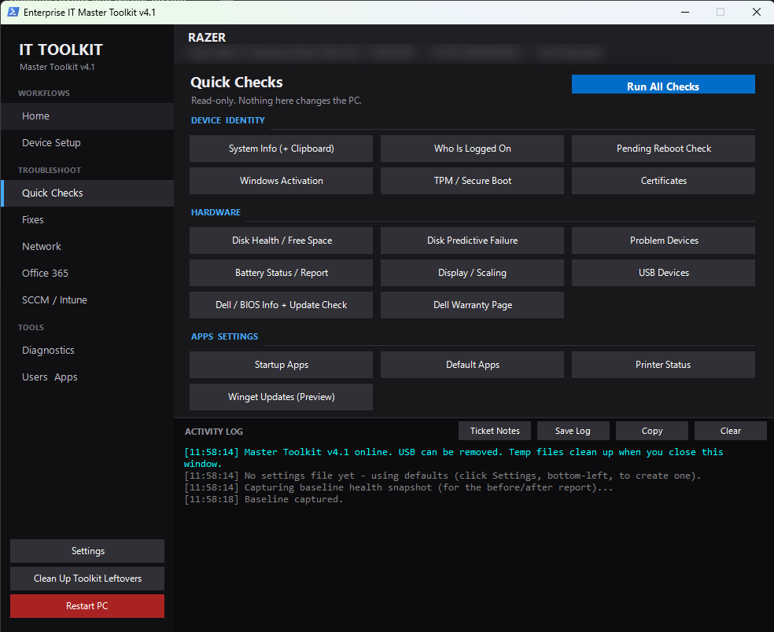
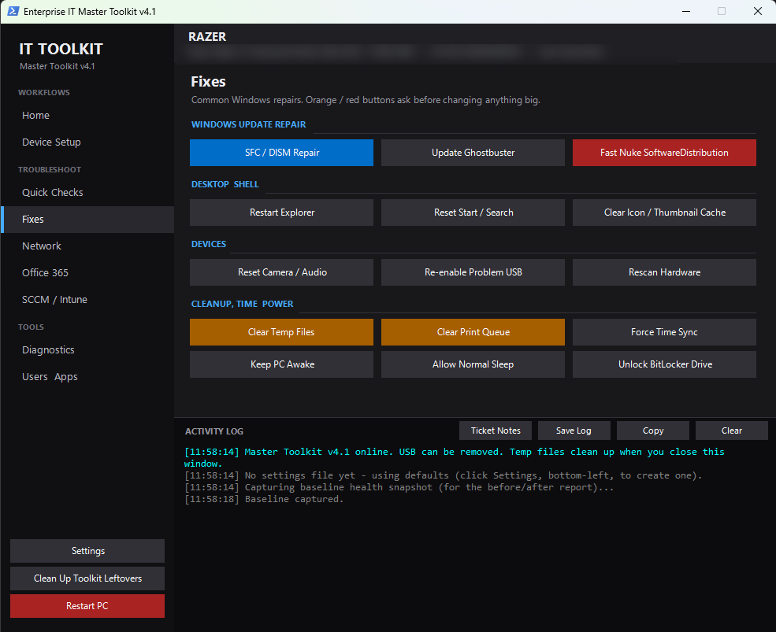
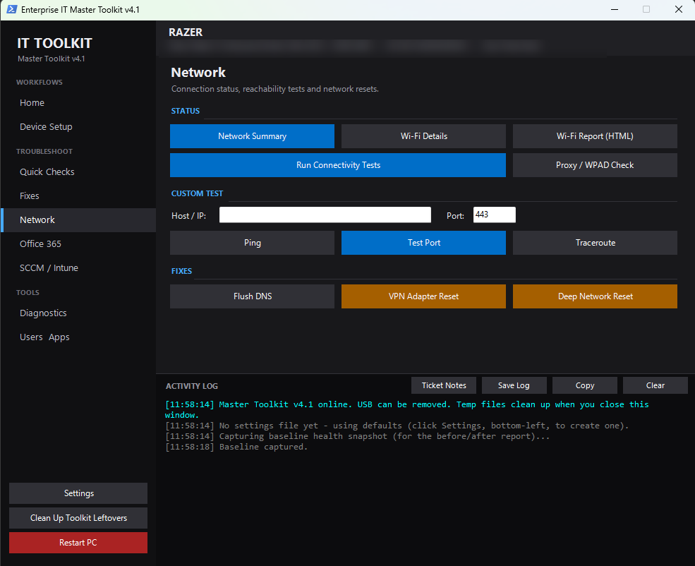
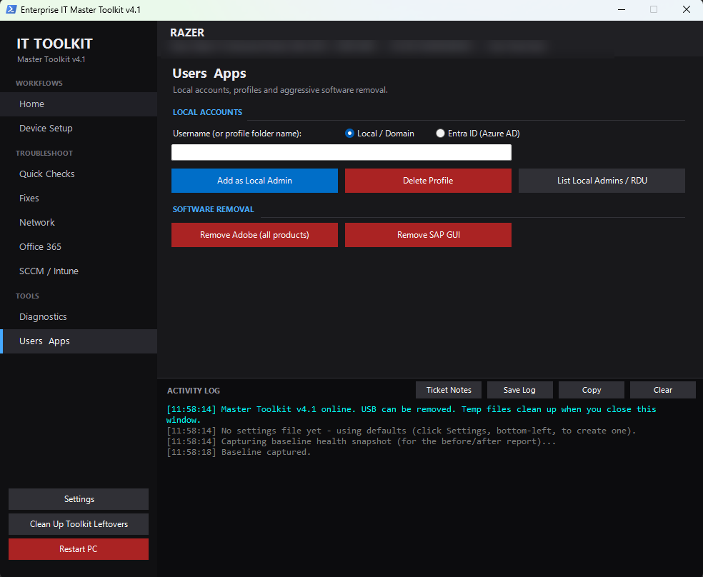

# Master Toolkit

**A single-file PowerShell/WinForms toolkit for provisioning and supporting Windows endpoints, from OOBE to a fully patched, Intune-ready device.**

Master Toolkit is a single `.bat` file that you run from a USB stick. It opens as a full GUI with about 199 functions across eight tabs. It was built to make device imaging repeatable: one click at the OOBE screen captures the Autopilot hash, sets time zone and power, and then patches Windows and Dell firmware. It restarts, reopens itself and keeps going until the device checks out as fully patched.

> In production use, this cut Windows Update time per device from **4–5 hours to about 1 hour**. It also saved **about 30 minutes per machine** on Autopilot hashing and initial setup, at a volume of **30–40 devices a day**.



<details>
<summary><b>More screenshots</b></summary>

| Device Setup | Quick Checks |
|---|---|
|  |  |

| Fixes | Network |
|---|---|
|  |  |

| Users & Apps | |
|---|---|
|  | |

</details>

---

## Why it exists

Imaging new devices by hand meant the same steps every time. You opened Shift+F10 at OOBE, ran `Get-WindowsAutopilotInfo`, and ran Windows Update over and over. You ran Dell Command | Update separately. You restarted and logged back in, then repeated all of that until nothing was left to install. Each step was easy, but the whole process was slow and inconsistent, and it needed someone watching it.

Master Toolkit chains those steps together and makes each one reliable. A technician can start OOBE Prep, walk away, and come back to a verified device.

## Features

| Tab | What it does |
|---|---|
| **Home** | OOBE Prep, Run Master Update, Verify Fully Patched, System Cleanup, Copy Ticket Notes, Before/After Report |
| **Device Setup** | New PC setup (rename, time zone, power plan, standard apps via winget, BitLocker key escrow to Entra ID/AD), Autopilot hash extraction |
| **Quick Checks** | Read-only checks: system info, activation, TPM/Secure Boot, certificates, disk health and SMART, problem devices with plain-English error codes, battery, Dell BIOS status |
| **Fixes** | SFC/DISM, Windows Update cache repair, Explorer/Start/Search resets, camera/audio and USB resets, print queue, time sync |
| **Network** | Adapter summary, Wi-Fi details and report, DNS and port tests against Entra/Intune/M365 endpoints, ping, port test, traceroute, network resets |
| **Office 365** | Teams cache clear, OneDrive reset, Office sign-in loop fix, Click-to-Run version/channel, quick and online repair |
| **SCCM / Intune** | ConfigMgr client status, all client actions, ccmrepair, ccmcache cleanup, Intune sync, IME restart, retrying failed Win32 apps, MDM diagnostics, built-in CMTrace-style log viewer |
| **Diagnostics / Users & Apps** | Event log viewer and exports, disk usage, support ZIP, BitLocker key export, local admin management, profile removal, Adobe and SAP removal |

Every session also produces **ticket notes**: what was run, the result, how long it took, and the key lines from the log, ready to paste into a ticket. It also produces an **HTML before/after health report**.

## How it works

A few design decisions do most of the work:

- **One self-contained file.** The `.bat` file is a polyglot: it runs as a batch file, then passes itself to PowerShell with `-ExecutionPolicy Bypass`. It also re-launches with administrator rights if it wasn't started elevated. There's nothing to install.
- **The USB can be removed.** On launch, the toolkit copies itself to `ProgramData\IT-Toolkit-temp`, runs from that copy, and deletes it when you close the window. No logs or files are left on the user's PC.
- **The window never freezes.** Windows Update runs through the Windows Update Agent COM API in a separate background runspace. Its log messages come back to the window through a concurrent queue, so the GUI keeps responding during long installs.
- **Updates resume after each restart, with no one signed in.** When updates need a restart, the toolkit registers a SYSTEM startup task. That task waits for the OOBE screen or any user's desktop, then uses `CreateProcessAsUser` to put the toolkit back in that session. It's the same technique `psexec -s -i` uses. After 5 restart cycles it stops, so it can't loop forever.
- **Dell updates that handle failure.** It installs Dell Command | Update and .NET 8 from the USB if they're missing. It waits for AC power before BIOS updates, and suspends BitLocker automatically. It shows DCU's progress live in the log, translates every DCU exit code, and recovers on its own when the Dell service is busy or stopped (exit codes 3000–3005).
- **The device has to pass a final check.** Verify Fully Patched scans Windows Update and Dell and looks for a pending restart. If anything is left, it installs it, restarts, and checks again.
- **Prompts survive OOBE.** OOBE keeps pulling its own screen to the front. Every prompt is attached to the toolkit window, can only be closed with its own buttons, and reopens if something else closes it.
- **Autopilot CSVs are ready for Intune.** Each device gets its own `AP_<serial>.csv`, plus a running list with one row per serial. Running it again on the same device replaces that device's row instead of adding a duplicate. The format matches `Get-WindowsAutopilotInfo`, so Intune imports it without errors.

## Requirements

- Windows 10/11, Windows PowerShell 5.1, administrator rights
- Optional: `winget` (app installs and updates), an SCCM client and the Intune Management Extension (endpoint tabs), a Dell device (firmware updates)

## Quick start

1. Copy `Master_Toolkit.bat` to a USB drive.
2. *(Optional, for Dell)* Create a folder named `Dell` on the USB and put the Dell Command | Update installer and the .NET 8 Desktop Runtime (x64) installer in it.
3. *(Optional)* Copy `Master_Toolkit_Settings.example.json` to `Master_Toolkit_Settings.json` next to the `.bat` and edit it.
4. **At OOBE:** press Shift+F10, run the `.bat` from the USB, and click **OOBE Prep**. Import the Autopilot CSV it saves into Intune while the updates run.
5. **On a signed-in device:** run the `.bat` and pick any tool.

```
USB:\
├── Master_Toolkit.bat
├── Master_Toolkit_Settings.json      (optional)
├── Dell\                             (optional: DCU + .NET 8 installers)
├── Autopilot\AP_<serial>.csv         (created by the toolkit)
├── AutopilotDevices.csv              (created by the toolkit)
└── ITToolkit_Output\                 (reports saved during OOBE)
```

## Settings

`Master_Toolkit_Settings.json` sits next to the `.bat`. You can also click **Settings** in the sidebar to edit it. Changes apply when you close Notepad.

| Key | Purpose |
|---|---|
| `DefaultGroupTag` | Value filled in automatically for the Autopilot Group Tag |
| `ComputerNamePrefix` | Prefix for suggested PC names (prefix + serial, maximum 15 characters) |
| `TimeZone`, `PowerPlan`, `SleepTimeoutACMinutes`, `MonitorTimeoutACMinutes` | Device defaults used by OOBE Prep and New PC Setup |
| `StandardApps` | winget package IDs to install during New PC Setup |
| `NetworkTests` | Host/port pairs for the connectivity tests |
| `TicketSignature` | Text added to the end of ticket notes |

## Safety

- Anything destructive asks for confirmation first. The riskiest actions, such as deleting the update cache or deleting a profile, require you to type `YES`.
- The toolkit refuses to delete built-in profiles, the profile you're signed in with, or a profile that's currently loaded.
- Orphaned installer files are moved to a backup folder, not deleted. The Office identity cache is exported before it's cleared.
- The toolkit never writes BitLocker recovery keys to the on-screen log. It only saves them to a file when you choose to.

## Version history

See [CHANGELOG.md](CHANGELOG.md).

## License

MIT. See [LICENSE](LICENSE).
